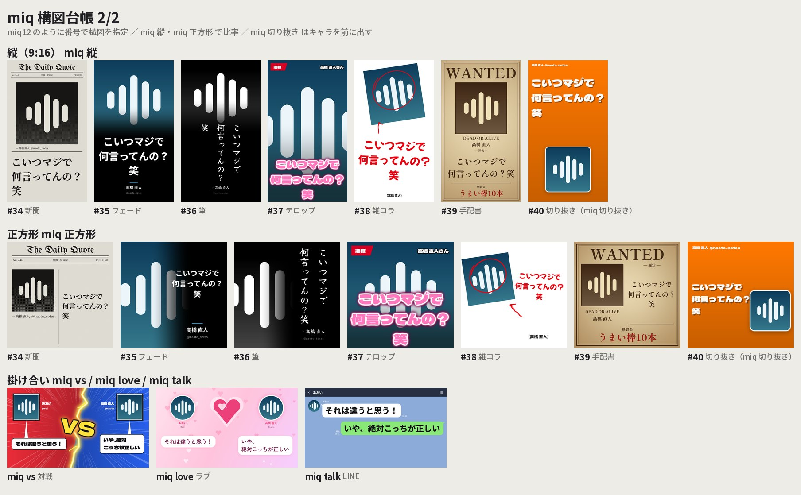

# MIQ Generator

画像と引用文からPNGを作る、オフラインのPython描画器です。Discord Botからも呼び出せます。


## 13の構図と掛け合い


オシャレさより **ネタ感** を優先して、構図を絞り込みました（大きいアイコン・大きい文字・クセのある書体）。
`--layout auto`（既定）は **その向きで描ける構図から均等に抽選** し、続けてその構図に合う書体を抽選します。
`--seed` で抽選を再現、`--layout` / `--font-family` で固定、`--category` で系統、`--orientation` で向きを絞れます。
`python miq.py --list-layouts` で番号・向き・書体候補の一覧を表示します。

**構図には固定の番号があります**（Botの `miq12` などで使用）。残した構図の番号は変えず、新しい構図は末尾（34〜）に追加しています。
削除した構図の番号（3, 4, 6〜11, 13, 14, 16〜24, 26〜33）は欠番です。
番号付きの一覧画像は `python miq_catalog.py`（`output/miq-layouts-*.png`）で作れます。

| 系統 | 構図（番号 名前 表示名） | 向き |
| --- | --- | --- |
| 定番 `classic` | 1 `classic` クラシック / 2 `mirrored` ミラー | 横 |
| カッコいい `cool` | 5 `noir` ノワール / 12 `duotone` デュオトーン | 横 |
| カッコいい `cool` | 34 `news` 新聞（The Daily Quote・網点写真）/ 35 `fade` フェード（写真が黒に溶ける）/ 36 `brush` 筆（筆文字の縦書き） | 横・縦・正方形 |
| かわいい `cute` | 25 `notebook` ノート | 横 |
| ネタ `neta` | 15 `manga` マンガ（集中線） | 横 |
| ネタ `neta` | 37 `telop` テロップ（バラエティ番組の字幕）/ 38 `zatsu` 雑コラ（ペイントで雑に作った感じ）/ 39 `wanted` 手配書（懸賞金つき） | 横・縦・正方形 |
| ネタ `neta`（指定時のみ） | 40 `cutout` 切り抜き：アイコンの背景を消してキャラを前に出し、後ろに本文を大きく | 横・縦・正方形 |



- 出力サイズの既定は 横 `640x360`・縦 `540x960`・正方形 `640x640`
  （環境変数 `MIQ_SIZE` / `MIQ_PORTRAIT_SIZE` / `MIQ_SQUARE_SIZE` で変更）。
  `--size` を指定すると、その縦横比から向きを判断します。番号や名前で選んだ構図は、その向きを描けない場合だけ構図自身の向き（横）で描きます。
- **2人の掛け合い**（`miq_dialogue.py`）: `vs` 対戦（赤青・稲妻・VS）/ `love` ラブ（ハート）/ `talk` LINE（影なしのLINE画面）。
  横は左右（LINEは上下に積む）、縦は上下に並べ、両者の本文は同じ文字サイズにそろえます。
- `duotone` はアイコンの主色、`cutout` はキャラと被らない派手な色から配色を決めます。
- `brush` はPangoで本物の縦組み（約物・長音の縦用字形、欧文は横倒し、数字と「!?」は全角で直立、絵文字は直立）。
  欧文が半分以上・アラビア文字などの右横書き・独自絵文字・220字超の本文では横組みにします。
- 装飾（集中線、テロップの見出し、雑コラの傾き、懸賞金、新聞の号数など）は本文から決まるので、同じ入力なら同じ画像になります。

### 切り抜き（`cutout`）

`miq_cutout.py` がアイコンの背景を透過します。初回だけモデルを取得してください（以後はオフライン）。

```bash
pip install onnxruntime           # requirements.txt にも含まれます
python scripts/setup_cutout.py    # isnet-anime（176MB・イラストに強い・1枚1〜2秒）
python scripts/setup_cutout.py u2netp   # 4.6MBの軽量版（速いが輪郭は粗め）。MIQ_CUTOUT_MODEL=u2netp で優先
```

- モデルがなくても、単色に近い背景なら境界色から切り抜きます。切り抜けない画像（写真全面・線画など）は、
  アイコンをそのままステッカー風に置きます。
- 同じアイコンの切り抜き結果はワーカー内でキャッシュするので、🎲・📐での描き直しは速くなります。
- Botの各ワーカーは初めての `miq 切り抜き` でモデルを読み込みます（約2秒）。`MIQ_CUTOUT_PRELOAD=1` で起動時に読み込みます
  （1プロセスあたり約300MB増えます）。

## 書体

**1枚の画像の中では書体を1つに統一** します（本文・欧文・名前・handleとも同じファミリー。太さだけ変えます）。
書体は構図ごとに相性のよい候補から抽選します（例: `brush` は筆、`zatsu` はポップ体・手書き）。
新聞の題字「The Daily Quote」だけはロゴとして UnifrakturMaguntia を使います。

| `--font-family` | 書体 |
| --- | --- |
| `gothic` | Noto Sans JP |
| `mincho` | Noto Serif JP |
| `maru` | Zen Maru Gothic |
| `shippori` | Shippori Mincho B1 |
| `dela` | Dela Gothic One |
| `dot` | DotGothic16 |
| `code` | M PLUS 1 Code |
| `klee` | Klee One |
| `rocknroll` | RocknRoll One |
| `pop` | Mochiy Pop One（創英角ポップ体風） |
| `potta` | Potta One（筆ポップ） |
| `syuku` | Yuji Syuku（筆） |
| `magic` | Yusei Magic（マジック手書き） |
| `hachimaru` | Hachi Maru Pop（丸文字） |

`--font` を指定するとそのフォント1つで全テキストを描きます。絵文字はカラー絵文字フォントを使います。

## 表示と改行

- 日本語は単語と付属語、欧文は単語、絵文字は結合列をまとめて改行します。
  例えば「じゃあ8時間ホモにな／るか」は「じゃあ8時間ホモに／なるか」になります。
- 禁則処理: 行頭禁止（句読点・閉じ括弧・小書き仮名・ASCIIの `)!?,.` など）、行末禁止（開き括弧）、
  「……」「——」の分離禁止、`100%の` のような数字＋記号＋助詞の一体化。
- 最終行が1〜2文字だけになる場合は前の行から1語送ります（CSSの `text-wrap: pretty` 相当）。
- **文字数上限・最低フォントサイズはありません。** 全文を対象に、縦横比を保って縮小します。
  1px未満の文字も仮想座標で配置し、巨大な中間画像を作らず描画します。縦だけの圧縮や末尾の省略はしません。
- 長いURLや単語も途中で割らないため、その語が収まるまで全体の文字サイズが小さくなります。
- **アスキーアート（AA）は折り返さず1ブロックで描きます**（Saitamaar / JetBrains Mono）。
  AA用フォントが描けない文字（絵文字・アラビア語・補助漢字など）を含む場合はAAとみなさず、
  通常のテキスト経路で描きます（無言で消さない）。
- アラビア語・ヘブライ語の双方向表示、インド系文字の連結、他言語のフォント補完はPangoで処理します。
  対応フォントが必要です。欠落する文字を検出した場合は導入を案内します。
- Unicode絵文字は色付き。肌色、国旗、ZWJ、キーキャップに対応します。
  Discord独自絵文字はIDに対応する画像を渡します。PNG出力なのでアニメーションは最初のフレームです。
- **Discord記法を整形します**: `**太字**` `*斜体*` `~~打消~~` `` `code` `` `> 引用` `# 見出し` の記号を外し、
  `||スポイラー||` は伏字（■）、`<@id>` `<@&id>` `<#id>` は `mentions` で渡した名前、`<t:…>` は日時に変換します。
  不要なら `markup=False` / `--raw`。

### pretext について

[chenglou/pretext](https://github.com/chenglou/pretext) はブラウザのCanvas `measureText` を前提にしたTypeScriptライブラリです。
このリポジトリはFreeType（Pillow）とPangoで描くため、そのまま組み込むと「測る書体エンジン」と「描く書体エンジン」が別になり、
改行位置と実際の描画幅がずれます。Node.jsの依存とプロセス間通信も増え、禁則処理もありません。
そこで中核の考え方（**prepare/layout の分離**: 語の分割と幅の計測を1回だけ行い、行組みは足し算だけで行う）をPythonに移植しました。
確定した行だけ実測してカーニングやはみ出しを検証し、ずれたときは実測で組み直します。

## 導入（Python 3.10以上 / Linux・Docker）

Ubuntu/Debian:

```bash
sudo apt-get install libpango-1.0-0 libpangocairo-1.0-0 libcairo2 libfontconfig1 \
  fonts-noto-core fonts-noto-cjk fonts-noto-color-emoji
python -m venv .venv
source .venv/bin/activate
pip install -r requirements.txt
python scripts/setup_fonts.py
```

`setup_fonts.py` は承認済みフォントとOFLライセンスを一度だけ取得し、固定SHA-256を確認します（合計約75MB）。
フォント本体はGitに含めません。取得後の画像生成にネット接続・画像生成AI・外部APIは不要です。
より広い文字種が必要なら `fonts-noto-extra` も導入してください。
Windows/macOSでは同じPython APIを利用できますが、Pango/Cairo/Fontconfigの別途導入が必要です。

Docker:

```bash
docker build -t miq-generator .
docker run --rm --network none -v "$PWD:/data" miq-generator \
  --avatar /data/demo-avatar.png --text '小さな発見が、明日を変える。' \
  --name '投稿者' --output /data/quote.png
```

## CLI

```bash
# 構図と書体を抽選
python miq.py --avatar avatar.png --text '引用したい本文' --name '表示名' --handle 'username'

# 構図・書体を固定、ネタ系だけから抽選、添付画像・HD出力
python miq.py --avatar avatar.png --text '本文' --layout telop --font-family pop -o quote.png
python miq.py --avatar avatar.png --text '本文' --category neta --seed 7
python miq.py --image photo.jpg --attachment --text-file quote.txt --size 1920x1080
```

| オプション | 説明 |
| --- | --- |
| `--avatar`, `--image` | 画像パス（必須）。PNG/JPEG/WebP/GIFなどPillowが読める画像 |
| `--text`, `--quote` / `--text-file` | 本文またはUTF-8ファイル。どちらか一方が必須 |
| `--name`, `--handle` | 表示名とユーザー名（省略可能） |
| `--output`, `-o` | 出力先。既定 `quote.png` |
| `--size` | 既定は向きごと（横 `640x360` / 縦 `540x960` / 正方形 `640x640`）。`854x480`、`1920x1080` など |
| `--layout` | `auto`（既定）、上表の構図名、または番号（`12`） |
| `--orientation` | `auto` の抽選を `landscape` / `portrait` / `square` に絞る |
| `--category` | `auto` の抽選を `neta` / `classic` / `cool` / `cute` に絞る |
| `--font-family` | `auto`（既定）または上表の書体名 |
| `--seed` | 構図と書体の抽選を再現する整数シード |
| `--attachment` | アイコン用の正方形切り抜きをせず、添付画像として配置（全面背景の構図ではトリミング） |
| `--align` | `classic` 構図の `right`（既定）/ `center` |
| `--raw` | Discord記法を整形しない |
| `--fast` | 2倍描画を省いて約2倍速（細い線や小さな文字はやや粗くなる） |
| `--font`, `--bold-font` | 全テキスト用 / 表示名だけに使うフォントファイル |
| `--emoji-font` | 絵文字フォントを指定 |
| `--italic-font` | `classic` などの欧文フォントを明示的に上書き（従来オプションを維持） |
| `--list-layouts` | 構図の番号・向き・書体候補の一覧を表示して終了 |

従来の環境変数 `MIQ_SIZE`、`MIQ_TEXT_ALIGN`、`MIQ_FONT`、`MIQ_EMOJI_FONT`、
`MIQ_ITALIC_FONT` も利用できます。

## Python / Discord Bot

```python
from pathlib import Path
from miq import render, render_bytes, warmup

render(
    Path("avatar.png"),
    "本文 👩🏽‍💻 <:wave:123> <@42>",
    Path("quote.png"),
    "表示名",
    "username",
    size="640x360",
    custom_emojis={"123": Path("wave.png")},
    mentions={"42": "たろう"},
)

# Bot向け: 画像はbytes/PIL画像のまま、結果はPNGのbytesと抽選された構図・書体
warmup()  # 起動時に辞書・書体・絵文字を読み込んでおく
png, layout, font_family = render_bytes(
    avatar_bytes, "本文", "表示名", "username", category="cute", seed=1234
)
# discord.File(io.BytesIO(png), 'quote.png')

# 向き・番号
png, layout, font_family = render_bytes(avatar_bytes, "本文", orientation="portrait")
png, layout, font_family = render_bytes(avatar_bytes, "本文", layout=28)

# 2人の掛け合い（left が返信先＝先に話した人、right が返信）
from miq_dialogue import Speaker, render_dialogue_bytes
png, mood, font_family = render_dialogue_bytes(
    Speaker(avatar_b, "先に言った方", "B", "b"),
    Speaker(avatar_a, "返信した方", "A", "a"),
    "vs",  # "love" / "talk"
    orientation="portrait",
)
```

- `render()` の既存の位置引数と戻り値（`None`）は維持しています。`output` にはパスか書き込み可能なバイナリストリームを渡せます。
- キーワード専用の引数: `layout`（名前か番号）、`font_family`、`category`、`orientation`、`seed`、`attachment`、`mentions`、`markup`、`date`、`fast`。
- `find_layout(12)` で番号→構図名、`default_size("portrait")` で向きごとの既定サイズを得られます。
- `choose_style(layout, font_family, category=…, seed=…)` で、描画せずに抽選結果だけを得られます。
- `custom_emojis` の値はパスでもbytesでも構いません。画像が渡されない独自絵文字は `:name:` で表示します。
- 同じ書体・入力・構図・seed・描画ライブラリのバージョンなら同じ画像を再生成できます。

描画はCPU処理なので、イベントループで直接実行しないでください。Pythonの処理部分はGILを持つため、
同時リクエストが多いBotでは `ProcessPoolExecutor(initializer=warmup)` で別プロセスに渡すのが最速です
（`asyncio.to_thread` でも動作します）。

### Bot

[`bot/example_bot.py`](bot/example_bot.py) は discord.py 2.x のBotです（コマンド解釈は `bot/commands.py`、
対象メッセージの集め方は `bot/gather.py`、描画プロセスで動く処理は `bot/jobs.py`）。

```bash
pip install -r requirements.txt -r bot/requirements.txt
DISCORD_TOKEN=... python bot/example_bot.py
```

引用したいメッセージに **返信して** 送ります（全角・大文字も可）。返信せずに送った場合は、直前のメッセージ（Botや他のmiqコマンドを除く）を引用します。

| 入力 | 動作 |
| --- | --- |
| `miq` | そのメッセージを引用 |
| `miqmiq` / `miqmiqmiq` … | その人の直前の発言も1つにまとめて引用（繰り返した数だけ・最大10件）。間に挟まった他人の発言は飛ばします（遡るのは100件・1時間まで） |
| `miq12` / `miqmiq12` / `miq 12` | 構図を番号で指定（繰り返し＝件数、数字＝構図） |
| `miq 切り抜き`（`cutout` `透過` も可） | アイコンの背景を消してキャラを前に出し、後ろに本文を大きく描く |
| `miq ネタ` | ネタ枠（マンガ・テロップ・雑コラ・手配書）から抽選 |
| `miq 縦` `miq 正方形` `miq 横` | 比率（`tall` `9:16` `square` `1:1` なども可） |
| `miq ネタ` `miq cool` `miq cute` `miq classic` | 系統 |
| `miq vs` / `miq love` / `miq talk`（`miq line` も可） | 返信先の人との掛け合い。各自の **連続した発言をすべて**（間隔10分・最大8件）描きます。返信でない場合は直前に話した別の人が相手 |
| `miq台帳` / `miq一覧`（返信不要） | 番号付きの構図一覧画像 |
| `miq help`（返信不要） | 使い方と、動いているBotのバージョン（コミット） |

オプションは組み合わせられます（例 `miqmiq 縦 ネタ`、`miq vs 縦`、`miq 切り抜き 縦`）。

- 添付画像・スタンプ（PNG/APNG/GIF）・GIFや画像のリンク（Tenorなど）も描きます。動くものは1フレーム目、
  複数枚は1枚に並べ、スポイラー画像はぼかします。画像だけのメッセージも引用できます。
- 返信の下に 🎲「別の構図」、📐「縦横」切り替え、系統メニュー。キャプションに `#番号 構図名 · 書体` を表示。
- 右クリック「Make it a Quote」も使えます。同じ人が同時に頼めるのは2件まで（`MIQ_MAX_PENDING`）で、それを超えると ⏳ を付けます。
- **失敗しても黙りません。** 描画に失敗したときや、引用するメッセージが見つからないときは、その旨を返信します。
- 起動時に全ワーカーを `warmup()` 済みにし、構図台帳も先に作っておきます。アイコン・絵文字は並列に取得してキャッシュします。
  各段階の所要時間（取得・描画・送信）をログに出すので、遅いときはどこが原因か確認できます。

#### 「miq1 や miq vs、miqmiq が反応しない」問題について

原因は、描画用のワーカープロセスが1つでも異常終了すると（メモリ不足でOSに強制終了される、ネイティブライブラリが落ちる等）、
`ProcessPoolExecutor` 全体が「壊れた」状態になり、二度と回復しないことでした。以後の描画はすべて `BrokenProcessPool`
で失敗し、その例外はログに出るだけで返信がないため、Botが無反応に見えます。
`miq台帳`（起動時に作り置き）と `miq help`（描画しない）だけは動き続けるので、「一部のコマンドだけ動かない」ように見えていました。

対策として、プールが壊れたら作り直して同じ依頼を再実行し、それでも失敗したら「うまく作れませんでした」と返信するようにしました。
あわせて次の不具合も直しています。

- 空白だけの行やゼロ幅文字だけの行を含む本文で、`classic` 以外の全構図が0除算で落ちていた。
- `miq vs` の相手として、Bot自身（の引用画像メッセージ）が選ばれることがあった。
- 返信せずに送ったコマンドは無反応だった（直前のメッセージを引用するように変更）。
- 連続で送ると5秒のクールダウンで捨てられていた（同時2件までは順に処理）。
- 「メッセージ履歴を読む」権限がないと `miqmiq` / `miq vs` が例外で止まっていた（対象の1件だけで描くように変更）。
- TenorなどのGIFリンクを元URLから取ろうとして失敗していた（Discordのプロキシ経由で取得）。

`miq help` の最後に動いているコミットが表示されるので、サーバーのBotが最新か確認できます。

## 速度

`python scripts/benchmark.py`（ウォーム時の中央値、同じ環境で計測）:

| | 値 |
| --- | ---: |
| 全12構図（抽選対象）640x360 の中央値 | **44.8ms**（旧27構図は 54.8ms） |
| 最速 `classic` / 最遅 `telop` | 29ms / 105ms |
| `cutout`（切り抜き）初回・同じアイコン2回目以降 | 約1.6秒 / **約70ms** |
| `warmup()`（Botの各ワーカー起動時） | 約1.9秒 → **約1.4秒** |

今回の改善:

- 構図を33→13に絞ったので、起動時の `warmup()` と台帳の作成が速くなりました。
- 文字の縁取り・雑コラの傾き・テロップの見出しは、文字のある範囲だけを処理（キャンバス全体を回転・ぼかししない）。
- 写真のグレー化は拡大前の小さい元画像で行い、テロップの暗幕やフェードの階調はサイズごとにキャッシュ。
- 切り抜きのマスクはアイコンごとにキャッシュし、🎲・📐の描き直しではネットワークを再実行しません。

主な改善:

- 改行のサイズ探索で、語の幅を一度だけ測り足し算で行を組む（pretext方式）。分割結果もキャッシュ。
- 文字は128pxで描いて縮小するのをやめ、実寸の書体で直接描画。
- 新構図は最大2倍で描いて `reduce` で縮小（LANCZOSより高速で同等の品質）。旧来の3倍描画は廃止。
- グラデーション・ぼかし・網点・ノイズはCの画素演算と縮小解像度で処理し、サイズごとにキャッシュ。
- 大きな写真は整数倍の `reduce` で先に縮め、拡大時はbicubicを使用。PNGの圧縮レベルを6→3に。
- PNG保存を独自の並列エンコーダ（Upフィルタ＋帯ごとのdeflate）に変更。同等サイズで約1/3の時間。
- 角丸マスクは四隅だけ超標本化（全面を4倍で描いた結果と画素単位で一致）。罫線は線の範囲だけ合成。
- 2倍描画の縮小をRGBで行い、乗算済みRGBAへの変換往復を省略。
- `warmup()` で全構図を一度描き、Pango/Cairoの読み込み（約1秒）や文字マップ解析を起動時に済ませる。

## リポジトリの同期

このリポジトリ（TKY-27/miq-generator）の `main` は、上流 [kuraneko1/miq-generator](https://github.com/kuraneko1/miq-generator)
の PR #4 統合済みの版（`2ed66ab`）から続いています。上流の `main` へPR #4 がまだ反映されていない場合は、
上流側でローカルの `main` を push してください。手元のクローンは次で合わせられます。

```bash
git remote add upstream https://github.com/kuraneko1/miq-generator   # 初回のみ
git fetch origin upstream
git checkout main && git merge --ff-only origin/main
```

## 検証

```bash
pip install pytest
python -m pytest -q
python scripts/benchmark.py   # 主要な構図の描画時間（ウォーム時）を計測
python scripts/gallery.py     # 全構図を output/gallery/ に描画し、一覧画像を作る
python miq_catalog.py         # Botの「miq台帳」と同じ番号付き一覧を output/ に作る
```

単語改行、禁則、孤立行、Pangoでの語の保護、縦書きの判定、結合文字、絵文字キャッシュ、長文末尾、
1px未満の縮小、多言語、全構図×画像比率×出力比率、1枚1書体、Discord記法、CLI/API、抽選、再現性を検証します。


デモにはリポジトリ内で合成した `demo-avatar.png` を使用しています。
第三者の投稿・アイコンや生成物を誤ってコミットしないよう、`quote.png`、`output/` はGitの対象外です。
本ツールはMake it a Quote風の独自実装で、公式Botではありません。
